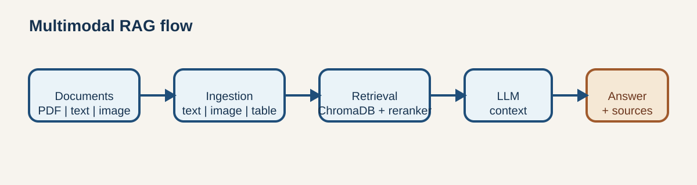

# Design Decisions

This document records the decisions that shape the current portfolio prototype. The goal is to
make trade-offs visible rather than imply that the project is a production deployment template.

## 1. Use Multimodal RAG

**Context:** Text-only retrieval would discard information contained in figures and tables.

**Decision:** Process text, tables and images as separate content types. Images receive a generated
description and remain available as visual context; tables retain their original content alongside a
summary.

**Alternatives considered:** Text-only OCR, image captions without visual context, or a separate
search system per modality.

**Trade-off:** The approach demonstrates multimodal retrieval, but image processing adds model
latency, provider capability requirements and additional token cost.

## 2. Use ChromaDB

**Context:** The portfolio demo needs a local vector store that can also run as a Docker service.

**Decision:** Use ChromaDB behind the existing vector-store abstraction.

**Alternatives considered:** FAISS for an embedded-only demo, a managed vector database, or a
relational database with a vector extension.

**Trade-off:** ChromaDB keeps local setup simple and supports the current use case. Persistence,
multi-user operations and public deployment hardening remain outside the current scope.

## 3. Retrieve Broadly, Then Rerank

**Context:** Initial vector similarity is efficient but can return several near-duplicate or weakly
ordered chunks.

**Decision:** Retrieve up to `k` candidates and optionally reduce them with a CrossEncoder or Cohere
reranker.

**Alternatives considered:** Similarity search only, MMR only, or a larger LLM-based reranking step.

**Trade-off:** Reranking can improve evidence ordering and context quality, but it adds CPU/API
latency. The evaluation protocol therefore includes an enabled/disabled comparison.

## 4. Keep Providers Replaceable

**Context:** A portfolio project should show awareness of cost, privacy and deployment constraints.

**Decision:** Keep LLM and embedding providers configurable through the existing factories and
settings.

**Alternatives considered:** Hard-code one hosted provider or create separate application branches
for local and hosted execution.

**Trade-off:** Provider capabilities are not identical, especially for vision. Configuration and
capability validation must remain explicit.

## 5. Separate Deterministic and Model-Based Evaluation

**Context:** RAGAS is useful but depends on an evaluator model and external service availability.

**Decision:** Report source, modality, answer-presence and latency metrics directly from responses;
report RAGAS metrics in a separate section.

**Alternatives considered:** Use only RAGAS, use only exact-match evaluation, or present all values
as equally reproducible.

**Trade-off:** The deterministic metrics are narrower, but their meaning and reproduction conditions
are clear. RAGAS provides semantic quality signals without being confused with a fixed benchmark.

## 6. Scope the System as Local Single-User

**Context:** Authentication, durable jobs and shared session storage would expand the project beyond
its current portfolio objective.

**Decision:** Keep the existing local, single-user scope and document the boundary explicitly.

**Alternatives considered:** Add authentication and distributed persistence now, or claim production
readiness without those controls.

**Trade-off:** The prototype remains focused and easy to run. It is not a public multi-user service.

## 7. Preserve the Existing Architecture

**Context:** The current layers already demonstrate ingestion, retrieval, providers, API, UI,
monitoring and evaluation responsibilities.

**Decision:** Improve quality measurement and documentation without moving responsibilities between
layers or introducing a new runtime service.

**Trade-off:** Existing limitations remain visible, but the project gains stronger evidence without
adding architectural complexity that is not required for this portfolio stage.

