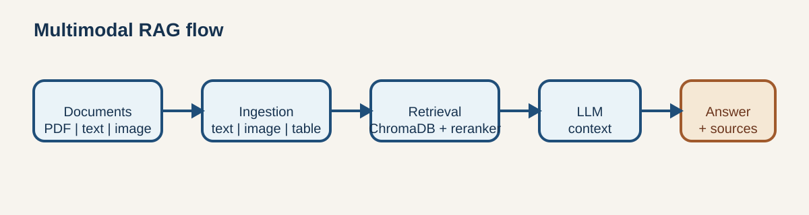

# Evaluation

This project separates software-quality verification from application-level RAG evaluation.
That distinction prevents model-dependent scores from being presented as deterministic facts.



## Evaluation Contract

The Golden Dataset is stored at
`tests/evaluation/data/golden_dataset.json`. It contains six questions:

| Modality | Samples |
| --- | ---: |
| Text | 2 |
| Table | 2 |
| Image | 2 |
| Total | 6 |

The dataset is identified by this SHA-256 hash:

```text
584f4a10266d3c78698972fe09c71edce71eee50a46c3dcbdfa3e925ba09f9e3
```

Every evaluation report also records the dataset hash, Git commit, runtime, provider configuration,
retrieval configuration and evaluation mode.

## Metrics

### Deterministic Metrics

These metrics are calculated directly from the RAG response and do not call an evaluation LLM:

| Metric | Definition |
| --- | --- |
| Source Hit Rate | Fraction of samples where an expected source is returned |
| Source MRR | Mean reciprocal rank of the first expected source |
| Modality Accuracy | Fraction of samples where the expected modality is retrieved |
| Non-empty Answer Rate | Fraction of responses containing an answer |
| Mean Latency | Mean response latency reported by the RAG chain |

Metrics are reported globally and separately for text, table and image samples. Source metrics only
include samples that define `expected_sources`. The rank is based on the deduplicated source list
returned in `RAGResponse`, not on hidden vector-store chunks.

For a `mixed` sample, modality accuracy requires at least two different source modalities. The
current Golden Dataset does not contain a mixed sample.

### RAGAS Metrics

RAGAS provides model-based judgements for:

- Faithfulness
- Answer Relevancy
- Context Recall
- Context Precision

These values are not deterministic. They depend on the evaluator model, provider availability,
prompt behavior and model version. They are therefore kept separate from the deterministic metrics.

## Reproduction

The normal evaluation requires model access and an indexed demo collection:

```bash
export VECTORSTORE_PERSIST_DIRECTORY=/tmp/multimodal-rag-evaluation
make demo-assets
make demo-index
make evaluate
```

To run only the deterministic metrics after indexing, without RAGAS calls:

```bash
export VECTORSTORE_PERSIST_DIRECTORY=/tmp/multimodal-rag-evaluation
PYTHONPATH=. .venv/bin/python scripts/evaluate.py \
  --skip-ragas \
  --output reports/evaluation/deterministic.json
```

To compare the reranker, use the same dataset and model configuration for both runs:

```bash
export VECTORSTORE_PERSIST_DIRECTORY=/tmp/multimodal-rag-evaluation
PYTHONPATH=. .venv/bin/python scripts/evaluate.py \
  --output reports/evaluation/reranker-enabled.json

RERANKER_ENABLED=false PYTHONPATH=. .venv/bin/python scripts/evaluate.py \
  --output reports/evaluation/reranker-disabled.json
```

The reports are intentionally written to the ignored `reports/evaluation/` directory because
provider responses can contain environment-specific and non-reproducible values. The current
successful run is summarized below; the raw reports remain local.

## Current Results

### Software Quality Gate

The local verification run completed on 2026-09-28:

| Check | Result |
| --- | --- |
| Pytest | 41 passed |
| Ruff | Passed |
| Mypy (`strict`) | Passed |
| `pip check` | Passed |
| Docker Compose config | Passed |

Pytest reports one existing Starlette/httpx deprecation warning. It does not fail the test suite.

### Application-Level RAG Evaluation

The evaluation was executed successfully on 2026-09-28 with the following setup:

| Setting | Value |
| --- | --- |
| Dataset | 6 samples, SHA-256 recorded above |
| Vector store | Isolated temporary Chroma store containing only the two demo assets |
| LLM | OpenAI `gpt-4o`, temperature `0.0` |
| Embeddings | OpenAI `text-embedding-3-large` |
| Retrieval | Similarity search, `k=20` |
| RAGAS evaluator | OpenAI `gpt-4o-mini` |
| RAGAS version | `0.3.1` |

The same dataset and isolated vector store were evaluated once with the CrossEncoder reranker and
once without it.

| Run | Reranker | Samples | Source Hit Rate | Source MRR | Modality Accuracy | Faithfulness | Answer Relevancy |
| --- | --- | ---: | ---: | ---: | ---: | ---: | ---: |
| Demo run | Enabled | 6 | 0.500 | 0.500 | 0.333 | 0.611 | 0.312 |
| Demo run | Disabled | 6 | 0.500 | 0.500 | 0.333 | 0.667 | 0.316 |

Additional results:

| Run | Context Recall | Context Precision | Non-empty Answer Rate | Mean Latency |
| --- | ---: | ---: | ---: | ---: |
| Reranker enabled | 0.500 | 0.500 | 1.000 | 2401 ms |
| Reranker disabled | 0.500 | 0.500 | 1.000 | 1301 ms |

### Interpretation

- The reranker did not improve source hit rate, source MRR, modality accuracy or RAGAS scores on
  this six-sample dataset.
- The reranker increased average latency by approximately 1.1 seconds.
- The disabled run scored slightly higher on Faithfulness and Answer Relevancy, but the sample is too
  small to treat that difference as statistically significant.
- Image retrieval was the weakest area: Source Hit Rate and Modality Accuracy were both `0.000` for
  image samples.
- Table retrieval performed best with Source Hit Rate and Source MRR both at `1.000`.
- Chroma emitted warnings for relevance values outside the documented `[0, 1]` range. This is an
  important limitation because configured relevance thresholds can filter expected results.

These results support keeping the reranker optional rather than treating it as an unconditional
quality improvement. They also identify image retrieval and relevance-score handling as the most
valuable candidates for the next technical review.

## Interpretation Rules

- A higher Source Hit Rate means the expected document was retrieved, not that the answer is correct.
- Source MRR also considers rank and therefore indicates whether expected evidence appears early.
- Modality Accuracy checks retrieval modality, not visual reasoning quality.
- RAGAS values must always be read together with the evaluator model and configuration.
- Six samples are suitable for a demonstration, not for a statistically significant benchmark.
